<div align="center">

# DUNGEON MASTER

**A retro 3D maze crawler that runs in your browser.**
Find the key or pick the gate lock, reach the exit, and trade your loot on the way down.


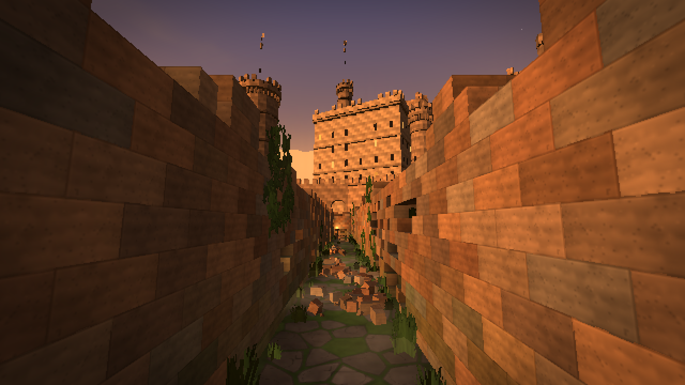

</div>

## Three worlds

<table>
<tr>
<td width="50%">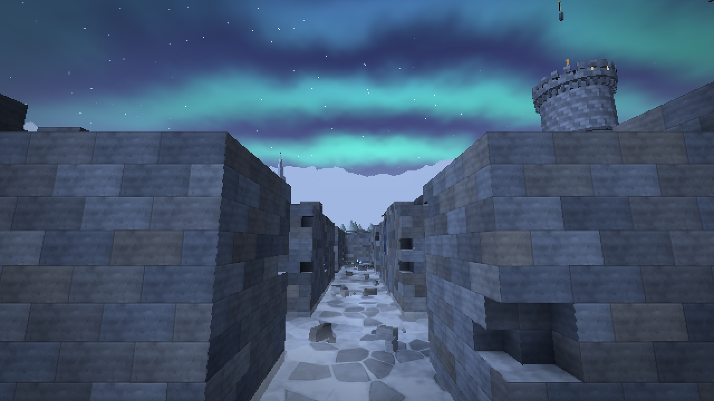</td>
<td width="50%">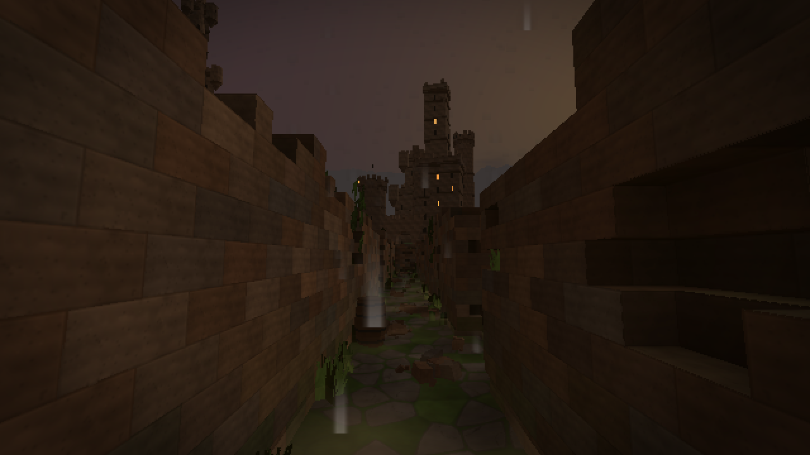</td>
</tr>
<tr>
<td colspan="2" align="center"><b>Outdoors.</b> Castle ruins in summer or winter, or a walled graveyard under the moon. The weather (clear, fog, storm, dust, snowfall, blizzard, northern lights, thick mist) changes every level.</td>
</tr>
<tr>
<td width="50%">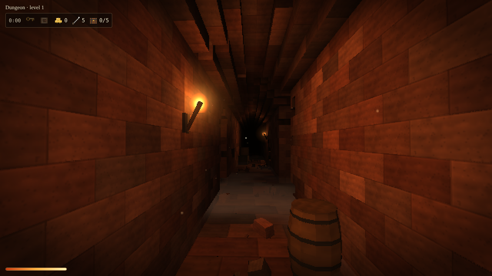</td>
<td width="50%">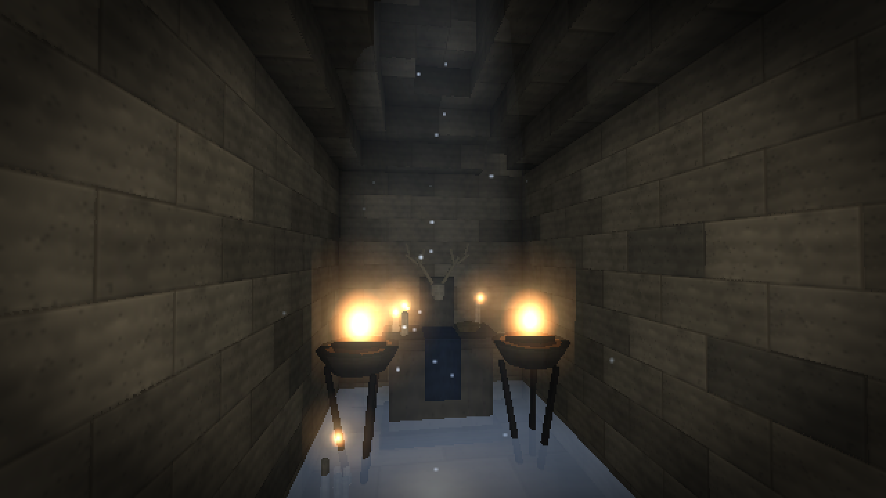</td>
</tr>
<tr>
<td colspan="2" align="center"><b>Underground.</b> Red-brick dungeons, limestone catacombs and a drowned cistern of arches over black water. Dark, cramped and full of treasure.</td>
</tr>
</table>

## What's down there

<table>
<tr>
<td width="50%">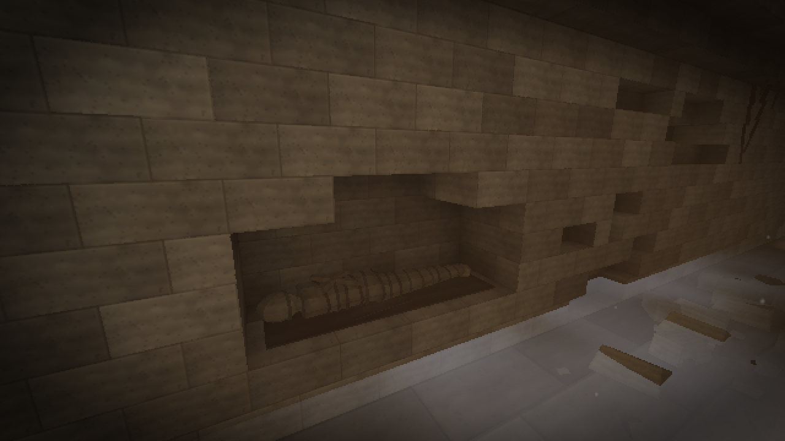<br><sub>Burial alcoves carved into the walls hold mummies and skeletons.</sub></td>
<td width="50%">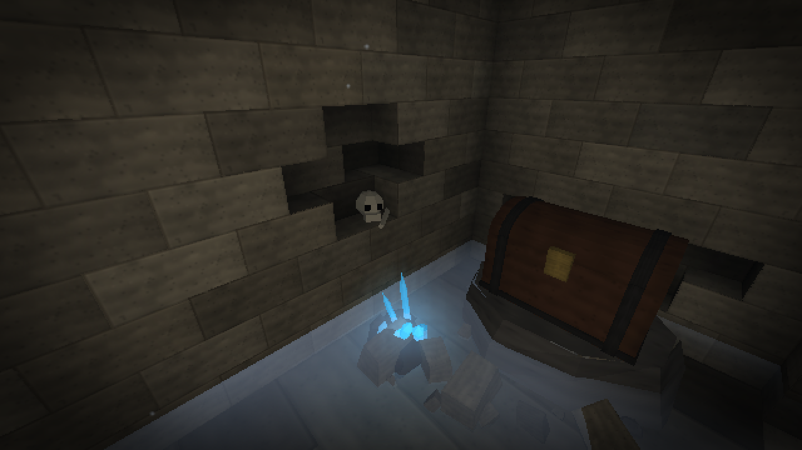<br><sub>Glowing crystals and mushrooms light the darkest corners.</sub></td>
</tr>
<tr>
<td width="50%">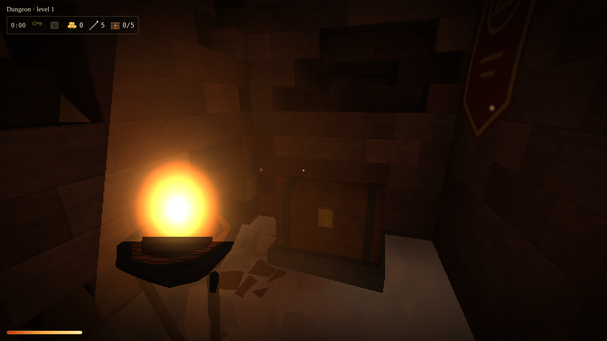<br><sub>Chests in dead ends hold the key, the map, gold and gems.</sub></td>
<td width="50%">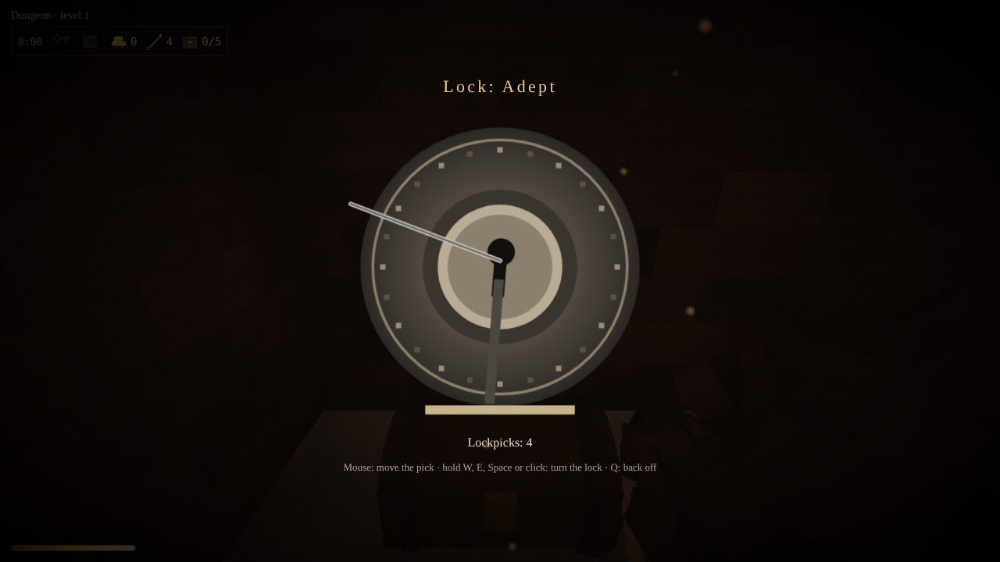<br><sub>Locked chests need a lockpick and a steady hand.</sub></td>
</tr>
<tr>
<td width="50%">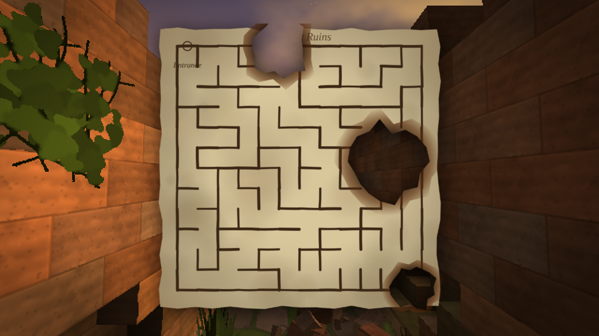<br><sub>Find the old parchment map, if the fire left enough of it.</sub></td>
<td width="50%">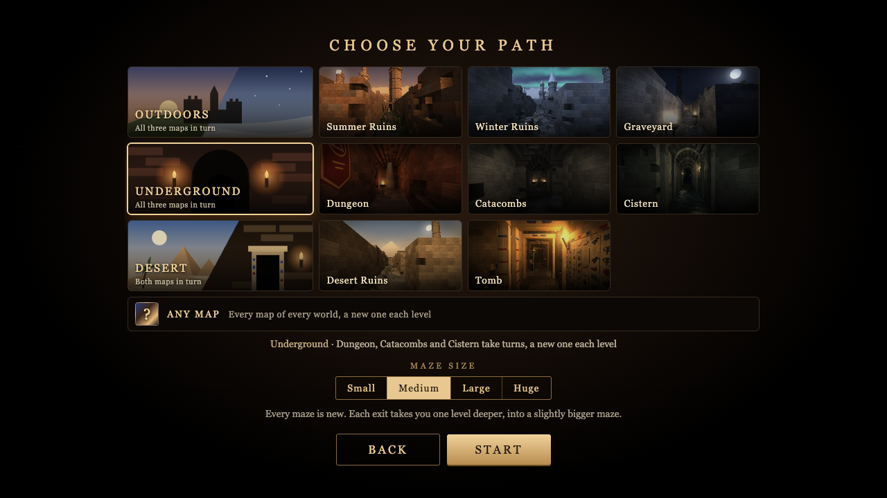<br><sub>Pick a world and a maze size, and every level is new.</sub></td>
</tr>
</table>

## Features

- **Every level is generated from scratch.** The maze, the walls, the props and the skyline are all new each time, and each exit takes you one level deeper into a bigger maze.
- **Voxel brickwork.** Walls are built from 25 cm voxels with real bricks: chipped corners, holes, niches, stepped vaults and crumbling tops.
- **The desert.** The third world: sandstone ruins half buried in sand, with pyramids, a sphinx and obelisks on the dunes, and the painted tombs beneath them, with glyph-covered walls, gilded doorways and sand trickling from the vault.
- **Pick your map.** Choose a world and let it roll a new map every level, pick one map by name for the whole run, or press **?** for any map of any world.
- **A living skyline.** Outdoor mazes are ringed by a castle with towers, gatehouses, keeps and halls, with temples, aqueducts and churches on the hills beyond. The forests around them are pixel-art billboards, the whole forest in one draw call.
- **Torch and shadows.** You come down without a torch: underground only the fires on the walls light the way. The trader sells one for a good sum. It burns down over time, and you relight it at any fire. Shadows patrol the corridors, and they don't stop while you pick a lock: lantern wraiths, cave spiders and floating watchers that never touch you but scream when they catch you in their gaze, calling every shadow on the level. If one catches you, the level starts over: the same maze with every chest closed again, and your purse back to what you brought in.
- **Loot.** You can find gold, lockpicks and 17 kinds of gems and soul gems in chests, burial urns and handfuls of coins left in wall pits. Pray at an altar for a blessing: stealth, sturdier lockpicks, swift feet, a ward against one catch, spare lockpicks or a brighter torch. Each maze has its own blessing, rolled once.
- **Trader and gate lock.** Between levels a wandering trader sells a torch, lockpicks and the next maze's map, and buys your gems. No key? The exit gate can be picked: two tumblers, one after the other.
- **Behind the grates.** Barred windows look out into more of the underworld: corridors, caves, catacombs, sewers or old mines.
- **Synthesised sound.** Footsteps, fire, dripping water, thunder and a Nordic choir are all generated live with WebAudio, without a single audio file.

## Play

There's no build step and nothing to install. Clone the repository and open `index.html` in a browser:

```sh
git clone https://github.com/kerminator-dev/Labyrinth.git
cd Labyrinth
open index.html        # or just double-click it
```

| Key | Action |
| --- | --- |
| <kbd>W</kbd> <kbd>A</kbd> <kbd>S</kbd> <kbd>D</kbd> | move |
| <kbd>Shift</kbd> | run |
| mouse | look |
| <kbd>E</kbd> | open, search, pick a lock or the gate, pray |
| <kbd>F</kbd> | throw a coin: shadows nearby go to see what clinked |
| <kbd>M</kbd> | map (once you've found it): held low and tilted, so you can walk and read; press again to hold it up flat, once more to put it away |
| <kbd>R</kbd> | new maze |
| <kbd>Esc</kbd> | menu |

When lockpicking, move the mouse to position the pick, then hold <kbd>W</kbd>, <kbd>E</kbd>, <kbd>Space</kbd> or the mouse button to turn the lock. Press <kbd>Q</kbd> to back off.

## Performance

The game is built to stay fast on modest hardware:

- the low-resolution pixel look is the main saving: the scene renders at a fraction of screen resolution
- **Auto quality** lowers the resolution further whenever the frame rate drops
- masonry and floors are compact indexed meshes: a brick face is one quad of small vertices
- bricks, props and decor are drawn with instancing; the scattered ones are merged into one mesh per stretch of maze
- all flames and halos are drawn in two batches, the light shafts in four, and the forests round the outdoor mazes in one
- a cheap grid ray test skips parts of the maze hidden behind walls, and the world behind the grates unless a grate is in view
- the sky is drawn last, so it is shaded only where nothing covers it

**Settings** has draw distance, pixel size, FOV, an FPS limit and a toggle for post effects.

## Under the hood

Plain JavaScript and [three.js](https://threejs.org/). There's no bundler, every file is a plain `<script>`, and they load in order:

| File | What it does |
| --- | --- |
| `js/00-util.js` | random numbers, Perlin noise, settings |
| `js/01-textures.js` | procedural canvas textures |
| `js/02-themes.js` | themes and weather |
| `js/03-maze.js` | maze generation, collision grid |
| `js/04-walls.js` | voxel walls, vaults, niches, burial alcoves |
| `js/05-world.js` | floors, sky, terrain, lights, portals |
| `js/05b-props.js` | props, remains, glowing crystals and mushrooms |
| `js/05c-audio.js` | synthesised sound and music |
| `js/05d-gameplay.js` | chests, key and gate, lockpicking, torch, shadows |
| `js/05e-creatures.js` | pixel-art kit for the HUD icons and the tree sprites |
| `js/05k-mobs.js` | low-poly mobs: the lantern wraith, the cave spider and the watcher |
| `js/05f-ambience.js` | banners, roots, light shafts, ground fog, rubble |
| `js/05g-hud.js` | inventory panel |
| `js/05h-skyline.js` | castles, towers, temples and villages on the horizon |
| `js/05i-beyond.js` | the world behind the grates |
| `js/05l-decor.js` | theme details: doorways, painted walls, sand, cistern water, wisps |
| `js/06-game.js` | renderer, movement, culling, menu, main loop |
| `js/07-post.js` | bloom, colour grading, vignette |

## Tests

The tests drive the real game in headless Chromium through Playwright:

```sh
npm install
npm test              # walk-through, game mechanics, stress test over all themes, memory leaks
npm run shot dungeon  # screenshots of a level
```
